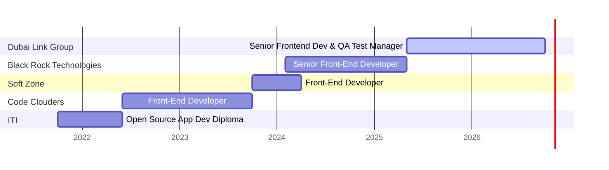
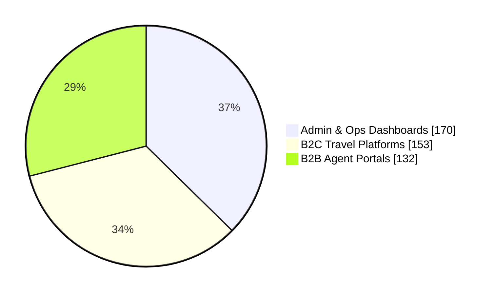

<h1 align="center">Hi 👋, I'm Nermeen Shehab</h1>
<h3 align="center">Senior Frontend Developer & QA Test Manager</h3>

5+ years building high-traffic, production-grade web apps for travel-tech, healthcare, real estate & e-commerce across the MENA market

  
  
  
  

---

## 👩‍💻 About Me

- 🚀 **Currently:** leading frontend engineering & QA at **Dubai Link Group**, across a B2C travel app, a B2B agent portal, an admin/ops dashboard and the corporate site
- 🧭 **Expert in** React, Next.js & TypeScript, with bilingual **EN/AR RTL** apps, component design systems and Jenkins/Kubernetes deployments
- 🔐 **Recently:** shipped a **single sign-on** integration across an AI-assisted booking assistant (**Claude + MCP**), an operations dashboard and the admin portal
- 👥 **Team lead:** task planning, code reviews, mentoring junior/mid developers, and setting coding & QA standards
- 📈 **Results:** BLACKROCK website, **+27% SEO · +24% performance · +17% accessibility**

---

## 📊 Career at a Glance

  
  
  
  

### 🗓️ Experience Timeline

### 🧩 Where My Org Commits Went (455+ commits, private repos)

---

## 💼 Featured Work

| Project | Domain | Highlights | Stack |
|---|---|---|---|
| **WebAdmin (Portal Dashboard)** | Admin / Ops | Real-time visibility into bookings & client finances; multi-role access | Next.js 15, Elasticsearch, Chart.js, Recharts, NextAuth |
| **GTE B2B** | B2B Travel | Agent booking platform with RBAC (Admin/Agent/Finance) & finance reconciliation | Next.js, NextAuth JWT, Google Maps |
| **Tripstick B2C App** | B2C Travel | Consumer hotel search & booking, full EN/AR RTL | Next.js 16, React 19.2, MUI v7, Tailwind v4 |
| **AI Booking Assistant (SSO)** | Internal AI Tooling | Shared token-handoff SSO; closed a token-leakage exposure | Next.js, FastAPI, Flask, Claude API, MCP |
| **Fazaa · Al Muayed · IVA Holidays · Smile Go** | B2C Travel (UAE) | 4 booking platforms on a shared Redux slice architecture; hotels, cars, flights, activities & transfers | Next.js 15, React 19, Redux Toolkit, Firebase |
| **BLACKROCK Website** | Corporate | +27% SEO, +24% performance, +17% accessibility | Next.js 15, Framer Motion, next-seo |
| **Corporate Booking Tool** | Enterprise Travel | Approval workflows, billing & a Storybook component library | React 18, Storybook, Jest |
| **iNUPCO UI** | Healthcare | Versioned design system for medical equipment procurement | React, TypeScript, Storybook |

<b>➕ More projects</b>

 

**STC Platform** (B2B travel) · **Dubai Link Group Site** · **Umrah Platform** · **ElSamady** (corporate catalogue + CMS) · **Ecomaster** & **Darna** (e-commerce, Angular) · **Maeyar** (e-learning) · **RoomHour** · **AFAAQPro** · **Asser Map** (GIS) · **Mnhga** (healthcare) · **Sodasyat** (real estate) · **SW Egypt Admin Dashboard** (logistics) · **QPortal** (no-code builder) · **EngLabs**

---

## 🛠️ Tech Stack

**Core** 

**Styling & UI**: MUI · Tailwind CSS · shadcn/ui · Radix UI · SCSS · Emotion · Framer Motion 

**State & Data**: Redux Toolkit · Zustand · TanStack Query · React Hook Form · Zod · Formik

**Auth & Security**: NextAuth · JWT · OAuth 2.0 · SSO / cross-service auth · Secure cookies

**i18n & RTL**: next-intl · i18next · ngx-translate · tailwindcss-rtl

**DevOps, Testing & Tools** 

**Backend & Databases** 

**AI**: Anthropic Claude API · Model Context Protocol (MCP)

---

## 📈 GitHub Stats

  
  

  

  

> 💡 Most of my work lives in **private company repositories**, so the public stats above show only part of it.

---

## 🎓 Education

- **Professional Postgraduate Diploma, Open Source Application Development**, ITI Mansoura · 2021–2022
- **Intensive Code Camp, Full Stack Web Development (PHP)**, ITI Mansoura · 2021
- **B.Sc. Special Chemistry**, Mansoura University · 2016–2020

<i>📫 Open to Senior Frontend / Frontend Lead opportunities. Let's connect!</i>

