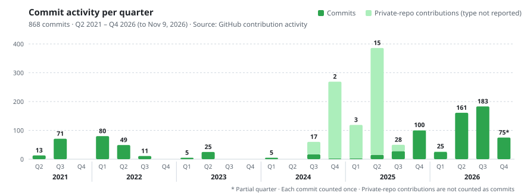

<h1 align="center">Nermeen Shehab</h1>

<b>Senior Frontend Developer &amp; QA Lead</b> 
React · Next.js · TypeScript · Frontend architecture · QA strategy &amp; test automation

  
  
  
  

---

## About

Senior Frontend Developer & QA Lead with 4+ years of experience building production web applications with React, Next.js, and TypeScript. I currently lead frontend engineering and QA at **Dubai Link Group**, working across B2C and B2B travel platforms and internal operations tools for the MENA market, and manage a team of 4–5 engineers.

My work combines three areas:

- **Frontend engineering** — shared architecture, reusable component libraries, bilingual English/Arabic (RTL) interfaces, performance and accessibility.
- **Quality assurance** — test planning, manual and automated testing, API and regression testing, security testing, and release validation.
- **AI-powered developer tooling** — an MCP server on the Claude API that makes API testing accessible to technical and non-technical users.

---

## Tech Stack

| Area | Technologies |
|---|---|
| **Frontend** | React · Next.js · TypeScript · JavaScript · Redux Toolkit · HTML · CSS · Tailwind CSS · Material UI · Storybook · responsive design · accessibility · performance optimization |
| **Testing & QA** | Playwright · Cypress · Jest · Postman / API testing · manual, regression &amp; security testing · test planning · release validation |
| **Backend & Integration** | REST APIs · Firebase · WebSockets · Elasticsearch · authentication · SSO · RBAC |
| **DevOps & Monitoring** | Docker · Jenkins · Kubernetes · CI/CD · Grafana |
| **AI & Developer Tools** | Claude API · Model Context Protocol (MCP) · AI-assisted API testing |

---

## Selected Work

**Dubai Link Group** — Senior Frontend Developer & QA Lead · *May 2025 – Present*

- Architected and shipped **Tripstick**, a B2C travel booking platform with full English/Arabic RTL support.
- Built **GTE**, a B2B agent platform with role-based access control.
- Developed **WebAdmin**, a travel operations platform covering booking management, finance and invoice reconciliation, user and role management, supplier and payment integrations, and analytics:
  - embedded Elasticsearch dashboards via iframes, using a dedicated read-only user and background authentication;
  - real-time notifications with WebSockets.
- Designed and implemented a shared **single sign-on (SSO)** integration across two internal applications, with secure token handoff that eliminates URL-based token exposure.
- Established shared frontend architecture and a reusable Storybook component library.
- Lead QA strategy: test planning, manual and automated testing, API and regression testing, security testing, and release validation.
- Contribute to CI/CD workflows with Docker, Jenkins, and Kubernetes, with Grafana monitoring.

**AI & QA Engineering**

- Built an **MCP server** on the Claude API that lets technical and non-technical users test API endpoints, generate reusable test scenarios from natural-language requests, and query booking analytics without code changes.

**Blackrock Technologies** — Senior Frontend Developer · *Feb 2024 – May 2026*

- Architected four B2C platforms on a shared frontend architecture and scaffolded Key Bookings as a fifth brand.
- Integrated Firebase push notifications across four B2C platforms.
- Built the BLACKROCK company website and raised its Lighthouse scores: SEO +27%, Performance +24%, Accessibility +17%, Best Practices 100.

Earlier: Frontend Developer at SoftZone (Oct 2023 – Apr 2024) and Code Clouders (Jun 2022 – Oct 2023) · Freelance Frontend Developer (Jun 2022 – Present). Full history on <a href="https://linkedin.com/in/nermeenshehab">LinkedIn</a>.

---

## Featured Projects

Most of my professional work lives in private company repositories. Public case studies are on my portfolio:

| Project | What it is | |
|---|---|---|
| **Tripstick** | B2C travel booking app (Next.js, English/Arabic RTL) | [Case study](https://nermeen-shehab.vercel.app/en/work/tripstick) |
| **WebAdmin** | Travel operations and management platform | [Case study](https://nermeen-shehab.vercel.app/en/work/webadmin) |
| **GTE B2B** | B2B agent booking platform with RBAC | [Case study](https://nermeen-shehab.vercel.app/en/work/gte-b2b) |
| **AI Booking Assistant — SSO** | Shared single sign-on across two internal apps | [Case study](https://nermeen-shehab.vercel.app/en/work/ai-booking-sso) |
| **BLACKROCK Website** | Company website with measured Lighthouse gains | [Case study](https://nermeen-shehab.vercel.app/en/work/blackrock) |
| **Umrah Platform** | Bilingual marketing and booking site, built through a v2 redesign | [Case study](https://nermeen-shehab.vercel.app/en/work/umrah-platform) |

[All projects →](https://nermeen-shehab.vercel.app)

---

## 📈 Commit Activity per Quarter

<picture>
  <source media="(prefers-color-scheme: dark)" srcset="./assets/commit-activity-dark.svg" />
  
</picture>

Data: GitHub contribution activity for @NermeenShehab (commits, including private repositories), Jun 2021 – Nov 9, 2026. Regenerate with <code>scripts/commit_activity.py</code>.

---

## Education

- **Professional Postgraduate Diploma (9 months)**, Open Source Application Development Track — Information Technology Institute (ITI), Mansoura · 2021 – 2022
- **Intensive Code Camp**, Full Stack Web Development (PHP) — Information Technology Institute (ITI), Mansoura · 2021
- **Bachelor of Science in Special Chemistry** — Mansoura University · 2016 – 2020

Open to Senior Frontend and Frontend Lead roles · Mansoura, Egypt

