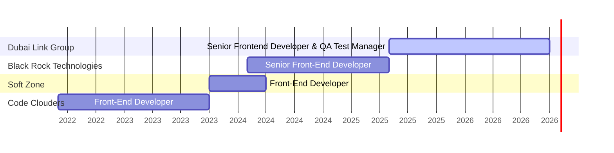
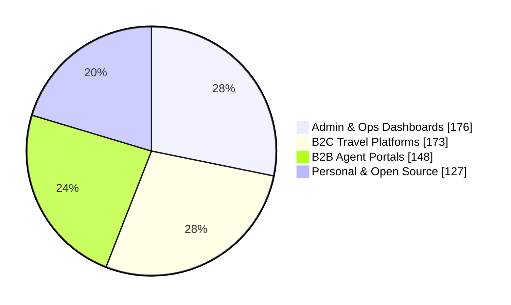
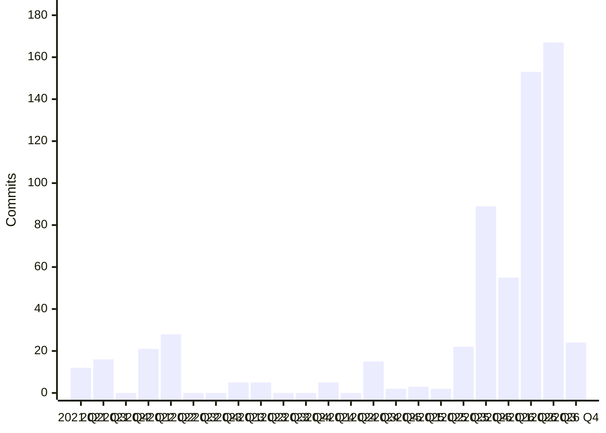

<h1 align="center">Hi 👋, I'm Nermeen Shehab</h1>
<h3 align="center">Senior Frontend Developer & QA Test Manager</h3>

5+ years building production-grade web apps · Currently at <b>Dubai Link Group</b>

  
  
  
  

---

## 👩‍💻 About Me

Senior Frontend Developer & QA Test Manager with 5+ years of experience architecting and delivering a wide range of high-traffic, production-grade web applications across two employers and freelance client work, spanning travel-tech, healthcare, real estate, and e-commerce domains — consistently focused on high code quality, strong performance, and scalable architecture. Currently leading frontend engineering and QA at Dubai Link Group, across its B2C travel app, B2B agent portal, admin/QA dashboard, and corporate web presence, serving the MENA market.

Expert in React, Next.js, and TypeScript, with a strong track record in bilingual (English/Arabic) RTL applications, component design systems, and Jenkins/Kubernetes-backed deployment pipelines. Recently expanded into cross-service authentication engineering, shipping a single sign-on integration across an internal AI-assisted booking assistant (Claude + MCP), an operations dashboard, and the company admin portal. Proven team leader who has managed, mentored, and set technical standards for cross-functional development teams. Reported results on the BLACKROCK website: 27% SEO improvement, 24% performance enhancement, and 17% accessibility improvement.

---

## 📊 Career at a Glance

  
  
  
  

### 🗓️ Experience Timeline

### 🧩 Where My Commits Went (624 commits, 50 repos)

### 📈 Commit Activity per Quarter

> 💡 Most of my work is in **private company repositories**. These charts are built from my own commit history across them.

---

## 💼 Experience

<b>Senior Frontend Developer & QA Test Manager</b> · Dubai Link Group · <i>May 2025 – Present</i>

- **Managed a development team** — assigned tasks, conducted code reviews, mentored junior/mid developers, and maintained code quality across travel brand platforms and enterprise tools
- Architected and shipped **Tripstick B2C App** using Next.js 16 and React 19.2 with MUI v7 and Tailwind CSS v4, adopting React 19 concurrent features and the latest MUI component API
- Built **WebAdmin (Portal Dashboard)** — Next.js 15 admin dashboard with Elasticsearch, Chart.js/Recharts analytics, and NextAuth multi-role access giving ops teams real-time visibility into bookings and client finances
- Developed **GTE B2B** — corporate booking platform with NextAuth JWT sessions, RBAC (Admin/Agent/Finance), Google Maps hotel display, and finance reconciliation tools
- Delivered **Dubai Link Group Site** with Next.js 16, Framer Motion animations, Google Maps, and multi-carousel layout
- Collaborated on a **single sign-on (SSO) integration** across two internal apps — an AI-assisted hotel-booking assistant with a booking-analytics panel (Next.js/FastAPI/MCP, powered by Claude), and an operations hotel-content mapping dashboard (Flask) — modifying both apps to support a shared token-handoff login flow and session-cookie proxy logic; removed SSO tokens from URL query parameters post-login to close a token-leakage exposure
- Own frontend architecture, reusable component systems, and folder structures; establish coding standards, performance/accessibility/security best practices, and CI/CD quality gates
- Define and oversee automated and manual testing strategies, bug tracking, and QA documentation; conduct code reviews and mentor frontend engineers; plan and track work in Jira
- Maintained full EN/AR bilingual support (next-intl v4) with pixel-accurate RTL layout mirroring across all consumer platforms
- Implemented multi-stage Docker builds, Next.js standalone output, and Jenkins CI/CD pipelines across the application portfolio; tracked deployment health and performance via Grafana and Kubernetes dashboards
- Enforced TypeScript strict mode and ESLint (core-web-vitals + unused-imports) standards across all codebases

<b>Senior Front-End Developer</b> · Black Rock Technologies · <i>Feb 2024 – May 2025</i>

- **Managed a development team** — assigned tasks, conducted code reviews, mentored junior/mid developers, and maintained code quality across travel brand platforms and enterprise tools
- Architected **4 Next.js 15 / React 19 B2C booking platforms** (Fazaa, Al Muayed, IVA Holidays, Smile Go) with consistent Redux Toolkit slice architecture for auth, multi-modal search (hotels/cars/flights/activities/transfers), localisation, and notifications; scaffolded a fifth (Key Bookings) as an additional brand entry point
- Developed **BLACKROCK Website** reporting: **27% SEO improvement** (100% of targets), **24% performance enhancement** (98% score), **17% accessibility improvement** (full compliance), and **100% boost in coding best practices**
- Built **Corporate Booking Tool (CBT)** — React 18 enterprise platform with approval workflows, billing history, and a genuine Storybook component library (auto-docs, RTL addon, real interaction testing)
- Developed **STC Platform** — B2B travel booking (flights/hotels) with RBAC, real-time availability, secure payments, and **Jest unit testing** (React, Redux, TypeScript, Storybook)
- Owned a client marketing site (Umrah travel platform) through **three ownership phases** — initial build, a full v2 redesign, and ongoing production maintenance with live transactional email (Resend)
- Established CLI scaffolding using generate-react-cli with custom templates for components, pages, API routes, and Storybook stories — standardising structure and reducing onboarding time
- Integrated Firebase v11 push notifications and analytics across 4 B2C platforms; dual-map solution (React Leaflet + Google Maps) on most B2C platforms
- Implemented next-seo + next-sitemap and Jenkins CI/CD pipelines with Kubernetes deployment across the portfolio

<b>Front-End Developer</b> · Soft Zone · <i>Oct 2023 – Apr 2024</i>

- Developed **Ecomaster** — digital multi-store marketplace connecting restaurant owners with wholesale suppliers (Angular, Angular Material, TypeScript, ngx-translate)
- Built **Darna** — luxury fashion e-commerce platform with secure payments, delivery management, and product filtering (Angular, Angular Material, TypeScript)
- Collaborated on Angular platforms **Maeyar** (e-learning system for universities/institutions), **RoomHour** (hourly hotel-reservation website & dashboard), and **AFAAQPro** (smart access-solutions website & dashboard for hospitality)
- Authored a **Gulp-based build pipeline** shared across all Angular platforms — minifying JS/CSS/HTML and optimizing images to reduce bundle size and improve load performance

<b>Front-End Developer</b> · Code Clouders · <i>Jun 2022 – Oct 2023</i>

- Built **Asser Map** — real-time geographic information exchange platform for geo-data integrated with electronic transaction systems (React, Redux Toolkit, Google Maps, i18next)
- Developed **Mnhga** — centralised medical platform for patient records, appointments, secure communications, and health tracking with Chart.js analytics and Storybook documentation
- Built **iNUPCO UI** — Storybook-documented React/TypeScript component design system powering NUPCO's medical equipment procurement, delivery, and client management platform, published as versioned internal packages with RTL Storybook addon support and Craco build tooling
- Delivered **QPortal** — website-building platform with OctoberCMS (Laravel) for non-technical users via drag-and-drop design tools
- Authored Storybook component documentation and configured ESLint/TypeScript standards across all projects

---

## 🚀 Featured Projects

| Project | Domain | What it does | Stack |
|---|---|---|---|
| **WebAdmin (Portal Dashboard)** | Admin Dashboard | Internal dashboard giving ops & finance teams real-time visibility into bookings and finances | Next.js 15, Elasticsearch, Chart.js, Recharts, NextAuth (multi-role), RBAC, TypeScript, ESLint, Jenkins CI/CD, Docker, Grafana, Kubernetes |
| **GTE B2B** | B2B Travel | Self-service B2B booking platform for travel agents, with live pricing & finance reconciliation | Next.js, NextAuth, JWT, RBAC (Admin/Agent/Finance), Google Maps API, TypeScript, ESLint, Jenkins CI/CD, Docker, Grafana, Kubernetes |
| **Tripstick B2C App** | B2C Travel | Consumer travel platform enabling seamless hotel search & booking, driving direct bookings | Next.js 16, React 19.2, MUI v7, Tailwind CSS v4, TypeScript, ESLint, next-intl (EN/AR RTL), Jenkins CI/CD, Docker, Grafana, Kubernetes |
| **AI Booking Assistant — SSO** | Internal AI Tooling | AI-powered booking assistant with instant conversational support, unified via SSO | Next.js, FastAPI, Flask, Anthropic Claude API, Model Context Protocol (MCP), SSO / cross-service auth, JWT, Secure cookies, Jenkins CI/CD, Docker, Grafana, Kubernetes |
| **Fazaa B2C** | B2C Travel (UAE) | UAE travel platform enabling search & booking across hotels, cars, flights, activities, transfers | Next.js 15, React 19, Redux Toolkit, Firebase, React Leaflet, Google Maps API, next-seo, next-sitemap, Jenkins CI/CD, Kubernetes |
| **BLACKROCK Website** | Corporate Site | Modern, high-performing company website built to strengthen brand credibility & search visibility — 27% SEO ↑, 24% performance ↑, 17% accessibility ↑ | Next.js 15, Framer Motion, next-seo, i18n, ESLint |
| **Corporate Booking Tool** | Enterprise Travel | Enterprise flight-booking tool with approval workflows & billing management | React 18, Storybook, Storybook Interaction Testing, RTL Storybook Addon, Jest |
| **iNUPCO UI** | Healthcare / Medical Equipment | Design system connecting suppliers, delivery & healthcare clients for medical equipment procurement | React, TypeScript, Storybook, RTL Storybook Addon, dnd-kit, Craco |

<b>➕ 16 more projects</b>

| Project | Domain | What it does |
|---|---|---|
| Dubai Link Group Site | Corporate Site | Corporate website for the group, with an animated, map-integrated brand presence |
| ElSamady | Corporate / E-Commerce | Corporate catalogue website & self-managed admin CMS for a packaging manufacturer |
| Umrah Platform | Corporate / Religious Travel | Marketing & booking site for Umrah travel packages, built to inform and reassure pilgrims |
| STC Platform | B2B Travel | B2B travel platform offering exclusive corporate deals & self-service flight/hotel booking |
| IVA Holidays | B2C Holidays | Consumer holidays booking platform enabling simple, secure booking across currencies |
| SW Egypt Admin Dashboard | Logistics / Ride-Hailing | Operations panel for end-to-end ride-hailing/logistics management |
| Ecomaster | E-Commerce | Wholesale marketplace connecting restaurant owners with suppliers — public website plus an admin dashboard to configure products, pricing, and vouchers/coupons |
| Darna | E-Commerce | Luxury fashion e-commerce storefront — public website plus an admin dashboard to manage products, categories, and promotional coupons |
| [Maeyar](https://maeyar.com) | Education | E-learning system for curriculum, scheduling & reporting across universities & institutions |
| RoomHour | B2C Travel | Hourly hotel-reservation platform for short-stay bookings |
| [AFAAQPro](https://afaaqpro.com) | Hospitality | Smart access-control solutions provider for hospitality & multi-industry clients |
| Sodasyat | Real Estate | Real estate platform connecting agents & buyers via map-driven property discovery |
| QPortal | CMS / Web Builder | No-code website builder for non-technical users to launch responsive sites |
| Asser Map | GIS / Transactional | Real-time geo-data exchange platform powering location-based transactions |
| Mnhga | Healthcare | Centralised medical platform enabling remote management of records, appointments & communication |
| EngLabs | Corporate Site | Fast, polished landing page representing the company's brand & services |

---

## 🛠️ Tech Stack

   
   
   

| Area | Skills |
|---|---|
| **Core Frameworks** | React · Next.js · Angular · TypeScript · JavaScript · Vue.js |
| **Styling & UI** | MUI · Tailwind CSS · shadcn/ui · Radix UI · Class Variance Authority (CVA) · Sass/SCSS · Emotion · Bootstrap · Angular Material · Framer Motion |
| **State Management** | Redux Toolkit · redux-persist · Zustand · TanStack React Query · React Context API |
| **Auth & Security** | NextAuth · JWT · OAuth 2.0 · Secure cookies · SSO / cross-service auth |
| **i18n & RTL** | next-intl · i18next · ngx-translate · tailwindcss-rtl |
| **Maps & Charts** | React Leaflet · Google Maps API · Chart.js · Recharts |
| **Integrations** | Firebase · Elasticsearch · Axios · Resend · REST APIs · Node.js · Laravel · Django · Python (FastAPI, Flask) |
| **AI / Emerging Tech** | Anthropic Claude API (exposure) · Model Context Protocol / MCP (exposure) |
| **DevOps & Tools** | Docker · Jenkins CI/CD · Kubernetes · AWS EC2 · Git/GitHub · ESLint · Storybook · SonarQube · Grafana · Vercel/Netlify · Postman · Gulp |
| **Testing** | Jest · Storybook Interaction Testing · ESLint static analysis |
| **Forms** | Formik · Yup · React Hook Form · Zod |
| **Databases** | MySQL · PostgreSQL · MongoDB · MariaDB · SQLite |

---

## 📈 GitHub Stats

  
  

  

---

## 🎓 Education

- **9-Month Professional Postgraduate Diploma**, Open Source Application Development Track · Information Technology Institute (ITI), Mansoura Branch · Oct 2021 – Jun 2022
- **Intensive Code Camp Program**, Full Stack Web Development using PHP Track · Information Technology Institute (ITI), Mansoura Branch · Apr 2021 – Aug 2021
- **Bachelor of Science — Special Chemistry** · Faculty of Science, Mansoura University · Sep 2016 – May 2020

<i>📫 Open to Senior Frontend / Frontend Lead opportunities. Let's connect!</i>

Last updated 2026-10-27
